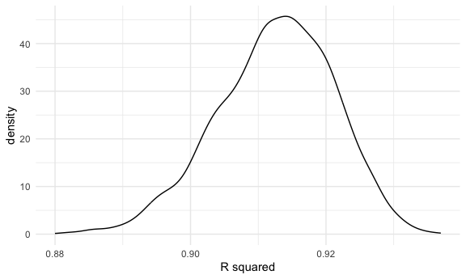
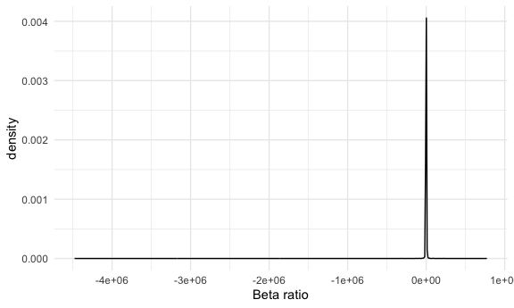
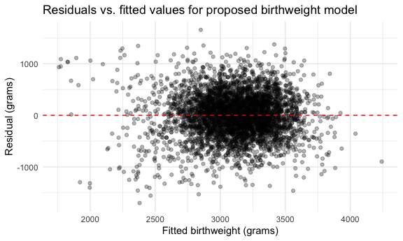
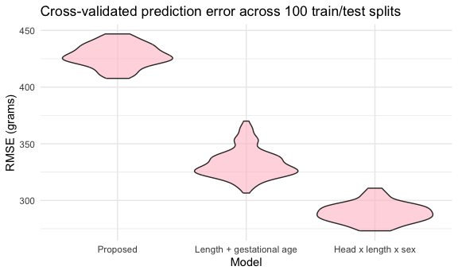

Homework 6
================

# Problem 1

``` r
homicide_data = read_csv("data/homicide-data.csv") |> 
  janitor::clean_names() |> 
  mutate(
    city_state = paste(city, state, sep = ", "),
    resolved = if_else(disposition == "Closed by arrest", 1, 0),
    victim_age = as.numeric(victim_age)
  ) |> 
  filter(
    !city_state %in% c("Dallas, TX", "Phoenix, AZ", "Kansas City, MO", "Tulsa, AL"),
    victim_race %in% c("White", "Black")
  ) |> 
  mutate(victim_race = fct_infreq(victim_race))
```

``` r
baltimore_df = 
  homicide_data |> 
  filter(city == "Baltimore") |> 
  select(resolved, victim_age, victim_race, victim_sex)

fit_balt_log = 
  baltimore_df |> 
  glm(resolved ~ victim_age + victim_sex + victim_race, data = _, family = binomial())

fit_balt_log_table = fit_balt_log |> 
  broom::tidy() |> 
  mutate(
    or = exp(estimate),
    ci_lower = exp(estimate - 1.96 * std.error),
    ci_upper = exp(estimate + 1.96 * std.error)
  ) |> 
  filter(term == "victim_sexMale") |> 
  select(term, log_or = estimate, or, ci_lower, ci_upper, p.value)
  

fit_balt_log_table |> knitr::kable(digits = 3)
```

| term           | log_or |    or | ci_lower | ci_upper | p.value |
|:---------------|-------:|------:|---------:|---------:|--------:|
| victim_sexMale | -0.854 | 0.426 |    0.325 |    0.558 |       0 |

The adjusted OR for solving homicides comparing male to female victims
is 0.426 (0.325, 0.558) keeping the other variables fixed.

``` r
city_or_df = 
  homicide_data |> 
  select(city_state, resolved, victim_age, victim_sex, victim_race) |> 
  nest(data = -city_state) |> 
  mutate(
    models = map(data, \(df) glm(resolved ~ victim_age + victim_sex + victim_race,
                                 data = df, family = binomial())),
    results = map(models, broom::tidy)
  ) |> 
  select(city_state, results) |> 
  unnest(results) |> 
  filter(term == "victim_sexMale") |> 
  mutate(
    OR = exp(estimate),
    CI_lower = exp(estimate - 1.96 * std.error),
    CI_upper = exp(estimate + 1.96 * std.error)
  ) |> 
  select(city_state, OR, CI_lower, CI_upper)
```

``` r
city_or_df |> 
  mutate(city_state = fct_reorder(city_state, OR)) |> 
  ggplot(aes(x = city_state, y = OR)) +
  geom_point() +
  geom_errorbar(aes(ymin = CI_lower, ymax = CI_upper), width = 0.3) +
  geom_hline(yintercept = 1, linetype = "dashed", color = "red") +
  coord_flip() +
  labs(
    x = NULL,
    y = "Adjusted OR (male vs. female victims)",
    title = "Odds of homicide being solved, male vs. female victims",
    caption = "Adjusted for victim age and race; 95% Wald CIs"
  ) +
  theme(axis.text.y = element_text(size = 6))
```


Albuquerque, NM; Stockton, CA; Fresno, CA; and Nashville, TN are the
only cities with ORs clearly above 1 for male vs female victims;
however, all of their CIs include the null value of 1. Otherwise, all
other cities have adjusted ORs at or below the null value of 1,
indicating that the odds of a homicide being solved for male victims is
lower than or equal to the odds of a homicide being solved for female
victims. Many cities have CIs entirely below 1, indicating that
homicides with male victims are significantly less likely to be solved
for those cities in comparison to those with female victims.

# Problem 2

## Setup

``` r
data("weather_df")

weather_df = weather_df |> 
  filter(name == "CentralPark_NY") |> 
  drop_na(tmax, tmin, prcp)

weather_bootstrap_df = 
  weather_df |> 
  modelr::bootstrap(n = 5000) |> 
  mutate(
    model_fits = map(strap, \(df) lm(tmax ~ tmin + prcp, data = df)),
    glance_results = map(model_fits, broom::glance),
    tidy_results = map(model_fits, broom::tidy)
  )
```

## $r^2$

``` r
r2_df = 
  weather_bootstrap_df |> 
  select(.id, glance_results) |> 
  unnest(glance_results) |> 
  select(.id, r.squared)

r2_df |> 
  ggplot(aes(x = r.squared)) + 
  geom_density() + 
  labs(x = "R squared")
```



``` r
r2_ci = r2_df |> 
  summarize(
    r2_estimate = mean(r.squared),
    ci_lb = quantile(r.squared, 0.025),
    ci_ub = quantile(r.squared, 0.975)
  )

r2_ci
```

    ## # A tibble: 1 × 3
    ##   r2_estimate ci_lb ci_ub
    ##         <dbl> <dbl> <dbl>
    ## 1       0.913 0.894 0.928

The distribution of $r^2$ is slightly left skewed with a peak around
0.915, indicating approximately 91.5% of the variation in tmax is
explained by the variation in tmin and prcp.

The confidence interval of $r^2$ is (0.894, 0.928).

## $\frac{\hat{\beta}_1}{\hat{\beta}_2}$

``` r
beta_ratio_df = 
  weather_bootstrap_df |> 
  select(.id, tidy_results) |> 
  unnest(tidy_results) |> 
  select(.id, term, estimate) |> 
  pivot_wider(names_from = term, values_from = estimate) |> 
  mutate(beta_ratio = tmin / prcp)

beta_ratio_df |> 
  ggplot(aes(x = beta_ratio)) + 
  geom_density() + 
  labs(x = "Beta ratio")
```



``` r
beta_ratio_ci = beta_ratio_df |> 
  summarize(
    ratio_estimate = mean(beta_ratio),
    ci_lb = quantile(beta_ratio, 0.025),
    ci_ub = quantile(beta_ratio, 0.975)
  )

beta_ratio_ci
```

    ## # A tibble: 1 × 3
    ##   ratio_estimate  ci_lb ci_ub
    ##            <dbl>  <dbl> <dbl>
    ## 1         -1459. -5616. 4587.

The distribution of $\frac{\hat{\beta}_1}{\hat{\beta}_2}$ has a very
heavy left tail. Most of the 5,000 estimates are centered around 0 but
it is hard to tell the distribution with the tails ranging from about
-1,700,000 to about to 400,000. This is due to the fact that
$\hat{\beta}_2$, the coefficience for precipitation, is close to 0 and
changes sign across the boostrap samples. Thus, I will make another plot
restricting the x-axis to look more closely at the results concentrated
around 0.

``` r
beta_ratio_df |> 
  ggplot(aes(x = beta_ratio)) + 
  geom_density() +
  labs(x = "Beta ratio") +
  coord_cartesian(xlim = c(-50000, 50000))
```


As we can see here, the distribution of
$\frac{\hat{\beta}_1}{\hat{\beta}_2}$ peaks just under 0.

The confidence interval of $\frac{\hat{\beta}_1}{\hat{\beta}_2}$ is
(-5616.445, 4586.923).

# Problem 3

``` r
birthweight = 
  read_csv("data/birthweight.csv", show_col_types = FALSE) |> 
  janitor::clean_names() |> 
  mutate(
    babysex = factor(babysex, levels = c(1, 2), labels = c("male", "female")),
    frace = factor(frace, levels = c(1, 2, 3, 4, 8, 9),
                   labels = c("white", "black", "asian", "puerto rican", "other", "unknown")),
    mrace = factor(mrace, levels = c(1, 2, 3, 4, 8),
                   labels = c("white", "black", "asian", "puerto rican", "other")),
    malform = factor(malform, levels = c(0, 1), labels = c("absent", "present"))
  )

summary(birthweight)
```

    ##    babysex         bhead          blength           bwt           delwt      
    ##  male  :2230   Min.   :21.00   Min.   :20.00   Min.   : 595   Min.   : 86.0  
    ##  female:2112   1st Qu.:33.00   1st Qu.:48.00   1st Qu.:2807   1st Qu.:131.0  
    ##                Median :34.00   Median :50.00   Median :3132   Median :143.0  
    ##                Mean   :33.65   Mean   :49.75   Mean   :3114   Mean   :145.6  
    ##                3rd Qu.:35.00   3rd Qu.:51.00   3rd Qu.:3459   3rd Qu.:157.0  
    ##                Max.   :41.00   Max.   :63.00   Max.   :4791   Max.   :334.0  
    ##     fincome               frace         gaweeks         malform    
    ##  Min.   : 0.00   white       :2123   Min.   :17.70   absent :4327  
    ##  1st Qu.:25.00   black       :1911   1st Qu.:38.30   present:  15  
    ##  Median :35.00   asian       :  46   Median :39.90                 
    ##  Mean   :44.11   puerto rican: 248   Mean   :39.43                 
    ##  3rd Qu.:65.00   other       :  14   3rd Qu.:41.10                 
    ##  Max.   :96.00   unknown     :   0   Max.   :51.30                 
    ##     menarche        mheight          momage              mrace     
    ##  Min.   : 0.00   Min.   :48.00   Min.   :12.0   white       :2147  
    ##  1st Qu.:12.00   1st Qu.:62.00   1st Qu.:18.0   black       :1909  
    ##  Median :12.00   Median :63.00   Median :20.0   asian       :  43  
    ##  Mean   :12.51   Mean   :63.49   Mean   :20.3   puerto rican: 243  
    ##  3rd Qu.:13.00   3rd Qu.:65.00   3rd Qu.:22.0   other       :   0  
    ##  Max.   :19.00   Max.   :77.00   Max.   :44.0                      
    ##      parity            pnumlbw     pnumsga      ppbmi            ppwt      
    ##  Min.   :0.000000   Min.   :0   Min.   :0   Min.   :13.07   Min.   : 70.0  
    ##  1st Qu.:0.000000   1st Qu.:0   1st Qu.:0   1st Qu.:19.53   1st Qu.:110.0  
    ##  Median :0.000000   Median :0   Median :0   Median :21.03   Median :120.0  
    ##  Mean   :0.002303   Mean   :0   Mean   :0   Mean   :21.57   Mean   :123.5  
    ##  3rd Qu.:0.000000   3rd Qu.:0   3rd Qu.:0   3rd Qu.:22.91   3rd Qu.:134.0  
    ##  Max.   :6.000000   Max.   :0   Max.   :0   Max.   :46.10   Max.   :287.0  
    ##      smoken           wtgain      
    ##  Min.   : 0.000   Min.   :-46.00  
    ##  1st Qu.: 0.000   1st Qu.: 15.00  
    ##  Median : 0.000   Median : 22.00  
    ##  Mean   : 4.145   Mean   : 22.08  
    ##  3rd Qu.: 5.000   3rd Qu.: 28.00  
    ##  Max.   :60.000   Max.   : 89.00

``` r
# checking variables to decide which to include in the model
summary(birthweight)
```

    ##    babysex         bhead          blength           bwt           delwt      
    ##  male  :2230   Min.   :21.00   Min.   :20.00   Min.   : 595   Min.   : 86.0  
    ##  female:2112   1st Qu.:33.00   1st Qu.:48.00   1st Qu.:2807   1st Qu.:131.0  
    ##                Median :34.00   Median :50.00   Median :3132   Median :143.0  
    ##                Mean   :33.65   Mean   :49.75   Mean   :3114   Mean   :145.6  
    ##                3rd Qu.:35.00   3rd Qu.:51.00   3rd Qu.:3459   3rd Qu.:157.0  
    ##                Max.   :41.00   Max.   :63.00   Max.   :4791   Max.   :334.0  
    ##     fincome               frace         gaweeks         malform    
    ##  Min.   : 0.00   white       :2123   Min.   :17.70   absent :4327  
    ##  1st Qu.:25.00   black       :1911   1st Qu.:38.30   present:  15  
    ##  Median :35.00   asian       :  46   Median :39.90                 
    ##  Mean   :44.11   puerto rican: 248   Mean   :39.43                 
    ##  3rd Qu.:65.00   other       :  14   3rd Qu.:41.10                 
    ##  Max.   :96.00   unknown     :   0   Max.   :51.30                 
    ##     menarche        mheight          momage              mrace     
    ##  Min.   : 0.00   Min.   :48.00   Min.   :12.0   white       :2147  
    ##  1st Qu.:12.00   1st Qu.:62.00   1st Qu.:18.0   black       :1909  
    ##  Median :12.00   Median :63.00   Median :20.0   asian       :  43  
    ##  Mean   :12.51   Mean   :63.49   Mean   :20.3   puerto rican: 243  
    ##  3rd Qu.:13.00   3rd Qu.:65.00   3rd Qu.:22.0   other       :   0  
    ##  Max.   :19.00   Max.   :77.00   Max.   :44.0                      
    ##      parity            pnumlbw     pnumsga      ppbmi            ppwt      
    ##  Min.   :0.000000   Min.   :0   Min.   :0   Min.   :13.07   Min.   : 70.0  
    ##  1st Qu.:0.000000   1st Qu.:0   1st Qu.:0   1st Qu.:19.53   1st Qu.:110.0  
    ##  Median :0.000000   Median :0   Median :0   Median :21.03   Median :120.0  
    ##  Mean   :0.002303   Mean   :0   Mean   :0   Mean   :21.57   Mean   :123.5  
    ##  3rd Qu.:0.000000   3rd Qu.:0   3rd Qu.:0   3rd Qu.:22.91   3rd Qu.:134.0  
    ##  Max.   :6.000000   Max.   :0   Max.   :0   Max.   :46.10   Max.   :287.0  
    ##      smoken           wtgain      
    ##  Min.   : 0.000   Min.   :-46.00  
    ##  1st Qu.: 0.000   1st Qu.: 15.00  
    ##  Median : 0.000   Median : 22.00  
    ##  Mean   : 4.145   Mean   : 22.08  
    ##  3rd Qu.: 5.000   3rd Qu.: 28.00  
    ##  Max.   :60.000   Max.   : 89.00

We can see from the summary that the minimum and maximum values for
pnumblw and pnumsga are 0, so we will not include these in the model.
The mean for parity is also 0.002, so we will not include this in the
model either.

Considering this, in addition to high correlations between certain
variables, we will make a linear model.

The dataset contains 4342 children and 20 variables. Sex, father’s race,
mother’s race, and malformation status were converted from numeric codes
to factors. No observations fell into the “unknown” category for
father’s race or the “other” category for mother’s race, so these empty
levels will be dropped.

The summary shows a few issues:

- `pnumlbw` and `pnumsga` are 0 for every baby, so they contain no
  information and are to be removed.
- `parity` is almost always 0 (mean = 0.002), so it is also to be
  removed.
- Only 15 children have a malformation, which is too few to estimate an
  effect reliably.
- `menarche` has a minimum of 0, which is not biologically plausible and
  is likely a data entry error. It is thus not used in the model.

``` r
birthweight = 
  birthweight |> 
  mutate(across(c(frace, mrace), fct_drop)) |> 
  select(-pnumlbw, -pnumsga, -parity)
```

## Proposed model

I took a hypothesis-driven approach, choosing predictors based on known
determinants of fetal growth rather than using automated selection. The
model includes:

- Gestational age (`gaweeks`): longer gestation allows more time for
  fetal growth
- Smoking (`smoken`): smoking during pregnancy is known to restrict
  fetal growth
- Pre-pregnancy BMI (`ppbmi`) and weight gain (`wtgain`): maternal size
  and gestational weight gain reflect nutritional status and are both
  associated with fetal size
- Mother’s race (`mrace`): included as a proxy for structural and social
  factors associated with birthweight
- Baby’s sex (`babysex`): male infants are, on average, slightly heavier
  at birth
- Family income (`fincome`): a socioeconomic factor that may influence
  maternal nutrition and access to prenatal care

Several variables were deliberately excluded:

- Head circumference (`bhead`) and length (`blength`): measures of the
  baby’s size at birth, collected at the same time as the outcome,
  rather than upstream factors that determine birthweight
- Pre-pregnancy weight (`ppwt`), weight at delivery (`delwt`), and
  mother’s height (`mheight`): these are redundant with the included
  variables (`ppbmi` is calculated from weight and height, and `wtgain`
  = `delwt` − `ppwt`), so including them would introduce
  multicollinearity
- Father’s race (`frace`): correlated with mother’s race
- Malformations (`malform`), menarche, and mother’s age (`momage`): too
  rare, implausible values, or no strong rationale for inclusion beyond
  the variables already in the model

``` r
birthweight_lm = birthweight |>
  lm(bwt ~ gaweeks + smoken + ppbmi + wtgain + mrace + babysex + fincome, data = _)

birthweight_lm |>
  broom::tidy() |>
  knitr::kable(digits = 3)
```

| term              | estimate | std.error | statistic | p.value |
|:------------------|---------:|----------:|----------:|--------:|
| (Intercept)       |  538.644 |    94.699 |     5.688 |   0.000 |
| gaweeks           |   53.921 |     2.122 |    25.409 |   0.000 |
| smoken            |  -11.504 |     0.907 |   -12.688 |   0.000 |
| ppbmi             |   20.063 |     2.066 |     9.709 |   0.000 |
| wtgain            |    9.828 |     0.604 |    16.259 |   0.000 |
| mraceblack        | -285.505 |    15.268 |   -18.700 |   0.000 |
| mraceasian        | -120.381 |    66.295 |    -1.816 |   0.069 |
| mracepuerto rican | -175.894 |    29.612 |    -5.940 |   0.000 |
| babysexfemale     |  -84.749 |    13.005 |    -6.517 |   0.000 |
| fincome           |    0.579 |     0.273 |     2.124 |   0.034 |

``` r
birthweight |>
  modelr::add_predictions(birthweight_lm) |>
  modelr::add_residuals(birthweight_lm) |>
  ggplot(aes(x = pred, y = resid)) +
  geom_point(alpha = 0.3) +
  geom_hline(yintercept = 0, linetype = "dashed", color = "red") +
  labs(
    title = "Residuals vs. fitted values for proposed birthweight model",
    x = "Fitted birthweight (grams)",
    y = "Residual (grams)"
  )
```



The residuals are mostly centered around 0 across the range of fitted
values, suggesting a linear model is reasonable for most of the data.
However, there are some large residuals, and the spread appears a bit
wider at lower fitted values. These likely correspond to very preterm or
very small babies, whose birthweight is harder to predict from maternal
factors alone.

## Comparison models

Model 1 - length at birth and gestational age as main effects only:

``` r
birthweight_lm_2 = birthweight |>
  lm(bwt ~ blength + gaweeks, data = _)

birthweight_lm_2 |>
  broom::tidy() |>
  knitr::kable(digits = 3)
```

| term        |  estimate | std.error | statistic | p.value |
|:------------|----------:|----------:|----------:|--------:|
| (Intercept) | -4347.667 |    97.958 |   -44.383 |       0 |
| blength     |   128.556 |     1.990 |    64.604 |       0 |
| gaweeks     |    27.047 |     1.718 |    15.744 |       0 |

Model 2 - head circumference, length, sex, and all two- and three-way
interactions:

``` r
birthweight_lm_3 = birthweight |>
  lm(bwt ~ bhead * blength * babysex, data = _)

birthweight_lm_3 |>
  broom::tidy() |>
  knitr::kable(digits = 3)
```

| term                        |  estimate | std.error | statistic | p.value |
|:----------------------------|----------:|----------:|----------:|--------:|
| (Intercept)                 | -7176.817 |  1264.840 |    -5.674 |   0.000 |
| bhead                       |   181.796 |    38.054 |     4.777 |   0.000 |
| blength                     |   102.127 |    26.212 |     3.896 |   0.000 |
| babysexfemale               |  6374.868 |  1677.767 |     3.800 |   0.000 |
| bhead:blength               |    -0.554 |     0.780 |    -0.710 |   0.478 |
| bhead:babysexfemale         |  -198.393 |    51.092 |    -3.883 |   0.000 |
| blength:babysexfemale       |  -123.773 |    35.119 |    -3.524 |   0.000 |
| bhead:blength:babysexfemale |     3.878 |     1.057 |     3.670 |   0.000 |

## Cross-validation

``` r
cv_df =
  crossv_mc(birthweight, 100) |>
  mutate(
    train = map(train, as_tibble),
    test = map(test, as_tibble)
  ) |>
  mutate(
    proposed_mod = map(train, \(df) lm(bwt ~ gaweeks + smoken + ppbmi + wtgain + mrace + babysex + fincome, data = df)),
    main_mod = map(train, \(df) lm(bwt ~ blength + gaweeks, data = df)),
    interaction_mod = map(train, \(df) lm(bwt ~ bhead * blength * babysex, data = df))
  ) |>
  mutate(
    rmse_proposed = map2_dbl(proposed_mod, test, \(mod, df) rmse(model = mod, data = df)),
    rmse_main = map2_dbl(main_mod, test, \(mod, df) rmse(model = mod, data = df)),
    rmse_interaction = map2_dbl(interaction_mod, test, \(mod, df) rmse(model = mod, data = df))
  )

rmse_long =
  cv_df |>
  select(starts_with("rmse")) |>
  pivot_longer(
    everything(),
    names_to = "model",
    values_to = "rmse",
    names_prefix = "rmse_"
  ) |>
  mutate(
    model = fct_inorder(model),
    model = fct_recode(
      model,
      "Proposed" = "proposed",
      "Length + gestational age" = "main",
      "Head x length x sex" = "interaction"
    )
  )

rmse_long |>
  ggplot(aes(x = model, y = rmse)) +
  geom_violin(fill = "pink", alpha = 0.6) +
  labs(
    title = "Cross-validated prediction error across 100 train/test splits",
    x = "Model",
    y = "RMSE (grams)"
  )
```



``` r
rmse_summary =
  rmse_long |>
  group_by(model) |>
  summarize(mean_rmse = mean(rmse))

rmse_summary |>
  knitr::kable(digits = 2)
```

| model                    | mean_rmse |
|:-------------------------|----------:|
| Proposed                 |    427.79 |
| Length + gestational age |    332.74 |
| Head x length x sex      |    289.17 |

The interaction model (head circumference, length, sex, and their
interactions) has the lowest cross-validated prediction error, with a
mean RMSE of about 289.2 grams. The main-effects model using length and
gestational age performs slightly worse (mean RMSE = 332.7 grams). My
proposed model has the highest prediction error (mean RMSE = 427.8
grams).

This result is expected as head circumference and length are measured at
birth and are direct measures of the baby’s size, so they are strong
proxies for birthweight and predict it very well. I deliberately
excluded these and instead uses maternal and pregnancy factors that
occur before birth. It therefore sacrifices predictive accuracy, but is
more useful for understanding which modifiable or structural factors are
associated with birthweight.
