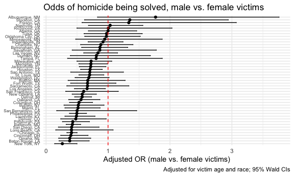
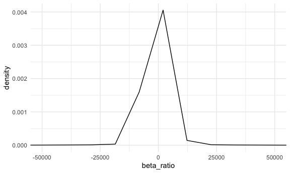

Homework 6
================

# Problem 1

``` r
homicide_data = read_csv("data/homicide-data.csv") |> 
  janitor::clean_names() |> 
  mutate(
    city_state = paste(city, state, sep = ", "),
    resolved = if_else(disposition == "Closed by arrest", 1, 0),
    victim_age = as.numeric(victim_age)
  ) |> 
  filter(
    !city_state %in% c("Dallas, TX", "Phoenix, AZ", "Kansas City, MO", "Tulsa, AL"),
    victim_race %in% c("White", "Black")
  ) |> 
  mutate(victim_race = fct_infreq(victim_race))
```

``` r
baltimore_df = 
  homicide_data |> 
  filter(city == "Baltimore") |> 
  select(resolved, victim_age, victim_race, victim_sex)

fit_balt_log = 
  baltimore_df |> 
  glm(resolved ~ victim_age + victim_sex + victim_race, data = _, family = binomial())

fit_balt_log |> 
  broom::tidy() |> 
  mutate(
    OR = exp(estimate),
    CI_lower = exp(estimate - 1.96 * std.error),
    CI_upper = exp(estimate + 1.96 * std.error)
  ) |> 
  filter(term == "victim_sexMale") |> 
  select(term, log_OR = estimate, OR, CI_lower, CI_upper, p.value) |> 
  knitr::kable(digits = 3)
```

| term           | log_OR |    OR | CI_lower | CI_upper | p.value |
|:---------------|-------:|------:|---------:|---------:|--------:|
| victim_sexMale | -0.854 | 0.426 |    0.325 |    0.558 |       0 |

``` r
city_or_df = 
  homicide_data |> 
  select(city_state, resolved, victim_age, victim_sex, victim_race) |> 
  nest(data = -city_state) |> 
  mutate(
    models = map(data, \(df) glm(resolved ~ victim_age + victim_sex + victim_race,
                                 data = df, family = binomial())),
    results = map(models, broom::tidy)
  ) |> 
  select(city_state, results) |> 
  unnest(results) |> 
  filter(term == "victim_sexMale") |> 
  mutate(
    OR = exp(estimate),
    CI_lower = exp(estimate - 1.96 * std.error),
    CI_upper = exp(estimate + 1.96 * std.error)
  ) |> 
  select(city_state, OR, CI_lower, CI_upper)
```

``` r
city_or_df |> 
  mutate(city_state = fct_reorder(city_state, OR)) |> 
  ggplot(aes(x = city_state, y = OR)) +
  geom_point() +
  geom_errorbar(aes(ymin = CI_lower, ymax = CI_upper), width = 0.3) +
  geom_hline(yintercept = 1, linetype = "dashed", color = "red") +
  coord_flip() +
  labs(
    x = NULL,
    y = "Adjusted OR (male vs. female victims)",
    title = "Odds of homicide being solved, male vs. female victims",
    caption = "Adjusted for victim age and race; 95% Wald CIs"
  ) +
  theme(axis.text.y = element_text(size = 6))
```



Albequerque, NM; Stockton, CA; Fresno, CA; and Nashville, TN are the
only cities with ORs well above 1 for male vs female victims; however,
all of their CIs include the null value of 1. Otherwise, all other
cities have adjusted ORs at or below the null value of 1, indicating
that the odds of a homicide being solved for male victims is lower than
or equal to the odds of a homicide being solved for female victims.

# Problem 2

## Setup

``` r
data("weather_df")

weather_df = weather_df |> 
  filter(name == "CentralPark_NY") |> 
  drop_na(tmax, tmin, prcp)

weather_bootstrap_df = 
  weather_df |> 
  modelr::bootstrap(n = 5000) |> 
  mutate(
    model_fits = map(strap, \(df) lm(tmax ~ tmin + prcp, data = df)),
    glance_results = map(model_fits, broom::glance),
    tidy_results = map(model_fits, broom::tidy)
  )
```

## $r^2$

``` r
r2_df = 
  weather_bootstrap_df |> 
  select(.id, glance_results) |> 
  unnest(glance_results) |> 
  select(.id, r.squared)

r2_df |> 
  ggplot(aes(x = r.squared)) + 
  geom_density()
```


``` r
r2_ci = r2_df |> 
  summarize(
    r2_estimate = mean(r.squared),
    ci_lb = quantile(r.squared, 0.025),
    ci_ub = quantile(r.squared, 0.975)
  )

r2_ci
```

    ## # A tibble: 1 × 3
    ##   r2_estimate ci_lb ci_ub
    ##         <dbl> <dbl> <dbl>
    ## 1       0.913 0.894 0.928

The distribution of $r^2$ is slightly left skewed with a peak around
0.915, indicating the linear model fits the data well with a high
correlation.

The confidence interval of $r^2$ is (0.894, 0.928).

## $\frac{\hat{\beta}_1}{\hat{\beta}_2}$

``` r
beta_ratio_df = 
  weather_bootstrap_df |> 
  select(.id, tidy_results) |> 
  unnest(tidy_results) |> 
  select(.id, term, estimate) |> 
  pivot_wider(names_from = term, values_from = estimate) |> 
  mutate(beta_ratio = tmin / prcp)

beta_ratio_df |> 
  ggplot(aes(x = beta_ratio)) + 
  geom_density()
```


``` r
beta_ratio_ci = beta_ratio_df |> 
  summarize(
    ratio_estimate = mean(beta_ratio),
    ci_lb = quantile(beta_ratio, 0.025),
    ci_ub = quantile(beta_ratio, 0.975)
  )

beta_ratio_ci
```

    ## # A tibble: 1 × 3
    ##   ratio_estimate  ci_lb ci_ub
    ##            <dbl>  <dbl> <dbl>
    ## 1         -1459. -5616. 4587.

The distribution of $\frac{\hat{\beta}_1}{\hat{\beta}_2}$ appears
approximately normal, maybe a bit right skewed, but the distribution is
so narrow due to the tails, I will make another plot restricting the
x-axis to view the peak a bit better.

``` r
beta_ratio_df |> 
  ggplot(aes(x = beta_ratio)) + 
  geom_density() +
  coord_cartesian(xlim = c(-50000, 50000))
```



As we can see here, the distribution of
$\frac{\hat{\beta}_1}{\hat{\beta}_2}$ peaks just under 0.

The confidence interval of $\frac{\hat{\beta}_1}{\hat{\beta}_2}$ is
(-5616.445, 4586.923).

# Problem 3

In this problem, you will analyze data gathered to understand the
effects of several variables on a child’s birthweight. This dataset,
available here, consists of roughly 4000 children and includes the
following variables:

babysex: baby’s sex (male = 1, female = 2) bhead: baby’s head
circumference at birth (centimeters) blength: baby’s length at birth
(centimeters) bwt: baby’s birth weight (grams) delwt: mother’s weight at
delivery (pounds) fincome: family monthly income (in hundreds, rounded)
frace: father’s race (1 = White, 2 = Black, 3 = Asian, 4 = Puerto Rican,
8 = Other, 9 = Unknown) gaweeks: gestational age in weeks malform:
presence of malformations that could affect weight (0 = absent, 1 =
present) menarche: mother’s age at menarche (years) mheigth: mother’s
height (inches) momage: mother’s age at delivery (years) mrace: mother’s
race (1 = White, 2 = Black, 3 = Asian, 4 = Puerto Rican, 8 = Other)
parity: number of live births prior to this pregnancy pnumlbw: previous
number of low birth weight babies pnumgsa: number of prior small for
gestational age babies ppbmi: mother’s pre-pregnancy BMI ppwt: mother’s
pre-pregnancy weight (pounds) smoken: average number of cigarettes
smoked per day during pregnancy wtgain: mother’s weight gain during
pregnancy (pounds) Load and clean the data for regression analysis
(i.e. use appropriate variable names, convert numeric to factor where
appropriate, check for the presence of missing data, etc.).

Propose a regression model for birthweight. This model may be based on a
hypothesized structure for the factors that underly birthweight, on a
data-driven model-building process, or a combination of the two.
Describe your modeling process and show a plot of model residuals
against fitted values – use add_predictions and add_residuals in making
this plot.

Compare your model to two others:

One using length at birth and gestational age as predictors (main
effects only) One using head circumference, length, sex, and all
interactions (including the three-way interaction) between these Make
this comparison in terms of the cross-validated prediction error; use
crossv_mc and functions in purrr as appropriate.

Note that although we expect your model to be reasonable, model building
itself is not a main idea of the course and we don’t necessarily expect
your model to be “optimal”.
